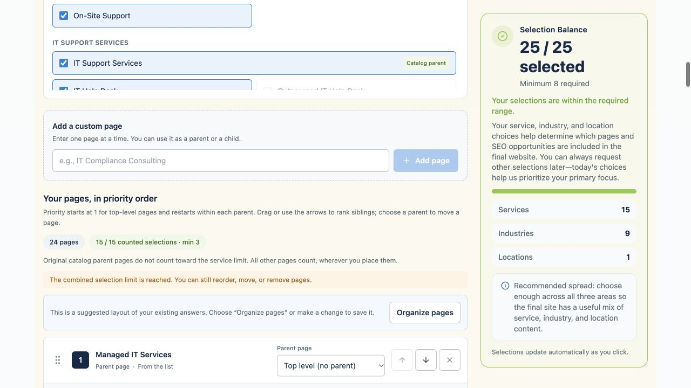

# Local verification record — October 27, 2026

All implementation and verification occurred in the separate `codex/local-page-organizer` checkout. No Git push, Base44 deploy, production data request, or Zapier call was made.

## Automated verification

- `npm test -- --reporter=dot`: **55 suites passed, 491 tests passed**.
- `npm run build:local`: passed.
- ESLint on the changed runtime/model/UI files: zero errors; one pre-existing unused-variable warning in `normalization.jsx`.
- `git diff --check`: passed.
- Actual modified Base44 function handlers were transpiled and exercised with fake SDK/network boundaries. Hosted execution was not tested.

New coverage includes model migration, custom labels and comma preservation, stable identity/counts through reparenting, two-level constraints, optional per-question adoption, repair/retry compatibility, old cached clients, two simultaneous hook clients, offline recovery archives, disk-write/rename failure rollback, and local network isolation.

## Browser and server checks

- Opened the local questionnaire with the Scout Networks legacy sample.
- Promoted Cloud Services and placed Cloud Solutions underneath it.
- Moved Internet Services into Network & Infrastructure Services.
- Added, grouped, and ranked a custom service page and a custom industry page.
- Reloaded and verified both questions retained their custom pages and parent assignments.
- Inspected the version-2 JSON with independent Q3/Q4 structures and the existing flat compatibility fields.
- Generated a PDF successfully through the browser. The local CSP permits same-origin PDF renderer frames while continuing to block external connections.
- Submitted through the actual questionnaire confirmation flow. One submission and two outgoing-payload capture records were saved locally; neither capture sent a webhook.
- Stopped and restarted the detached local server. Drafts, submission, and captures remained on disk.
- Loaded a separate fresh Scout sample for morning testing. Both Q3/Q4 remain legacy until edited; previous local test records remain available.

## Scope of this verification

The disk-backed preview is a local test adapter using the existing questionnaire and shared backend contract. It does not reproduce every Base44 hosted feature. Base44 schema acceptance, resource packaging, concurrent hosted writes, and a duplicate Zapier workflow still require isolated staging verification before release.
